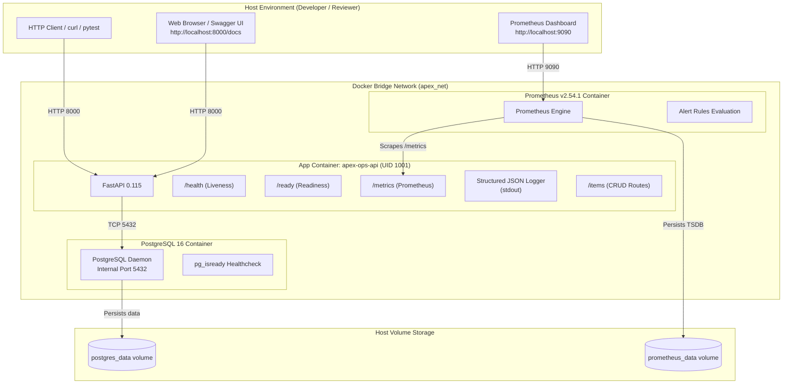
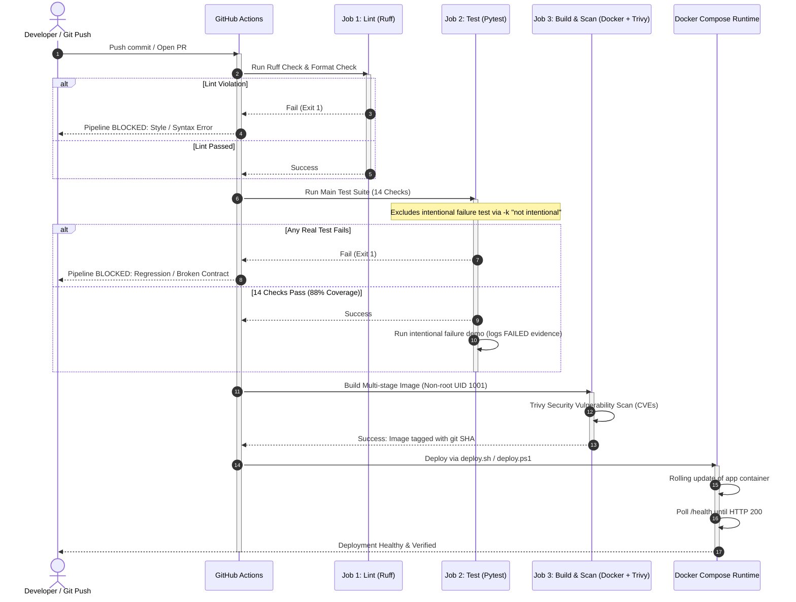
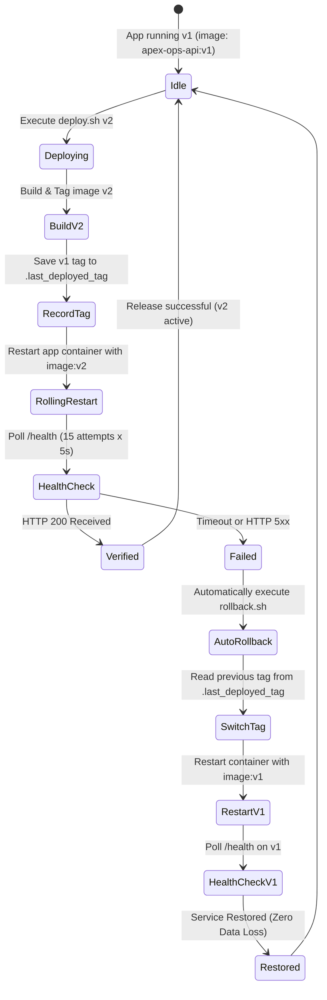

# System Architecture & CI/CD Pipeline

**Apex Operations API — Architecture & Flow Specifications**

---

## 1. System Overview & Runtime Topology

The local runtime stack is orchestrated via Docker Compose, isolated inside a private bridge network (`apex_net`).

---

## 2. CI/CD Pipeline Flow & Deployment Gate

The GitHub Actions workflow enforces test-driven delivery and vulnerability scanning prior to any container build.

---

## 3. Safe Release & Rollback Strategy

---

## 4. Key Architectural Attributes

| Attribute | Implementation | Production Rationale |
|---|---|---|
| **Separation of Probes** | `/health` (liveness: no external calls) vs `/ready` (readiness: DB probe) | Prevents cascading restart loops if DB is transiently slow or rebooting |
| **Least Privilege Container** | Custom UID 1001 (`appuser`), non-root, `no-new-privileges: true` | Eliminates container breakout and host compromise vectors |
| **Clean Multi-Stage Build** | Stage 1 `builder` (gcc, headers) → Stage 2 `runtime` (slim Python) | Shrinks attack surface by discarding compilers and headers |
| **Structured Observability** | JSON logs on stdout + Prometheus `/metrics` endpoint | Seamless ingestion into Loki/Datadog/CloudWatch and Prometheus/Grafana |
| **Storage Isolation** | Named volumes `postgres_data` and `prometheus_data` | Preserves transactional database state across container updates and rollbacks |
