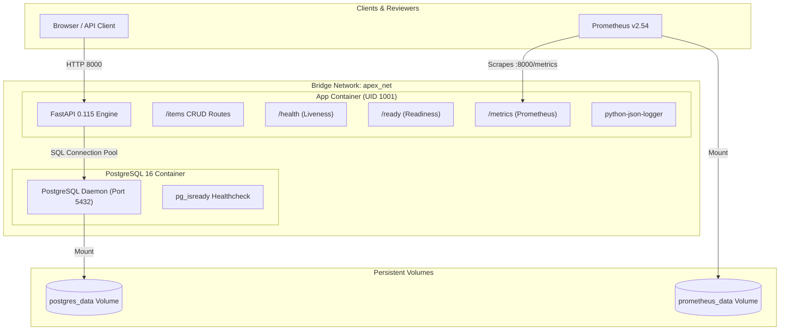

# Complete Project Documentation & Technical Report

**Project:** Apex Operations API  
**Candidate:** Jayakrishnasai ([koppolijayakrishnasai@gmail.com](mailto:koppolijayakrishnasai@gmail.com))  
**Assessment:** Junior DevOps Engineer Practical Assessment — Apex Operations  
**Date:** November 2026  
**Repository:** [https://github.com/Jayakrishnasai/apex-ops-api](https://github.com/Jayakrishnasai/apex-ops-api)  
**CI Actions:** [https://github.com/Jayakrishnasai/apex-ops-api/actions](https://github.com/Jayakrishnasai/apex-ops-api/actions)

---

## 1. Executive Summary & Objective

The objective of this assessment is to package, deploy, observe, and operate a production-ready **Apex Operations API** in a reproducible environment, establishing a dependable path from code commit to release.

This project delivers:
- A high-performance REST API built with **FastAPI** and **PostgreSQL**.
- Containerization using a hardened **multi-stage Dockerfile** running as non-root user `appuser` (UID 1001).
- Orchestration via **Docker Compose** featuring health checks, dependency gating, and named persistent storage.
- A 3-stage **GitHub Actions CI/CD pipeline** (Lint $\to$ Test $\to$ Build & Trivy Scan) that strictly blocks deployment if any test fails.
- An automated release and rollback mechanism based on **git SHA image tagging** with zero database data loss.
- Full-spectrum observability: structured JSON logs, `/health` and `/ready` probes, Prometheus metrics scraping, and alert definitions.
- Comprehensive security hygiene: zero committed secrets, least-privilege configurations, and a cost-effective cloud roadmap.

---

## 2. Architecture & Design Principles

### 2.1 System Architecture



### 2.2 Probe Separation (Liveness vs Readiness)

A core DevOps architectural pattern implemented here is the strict separation between liveness and readiness probes:

1. **Liveness Probe (`/health`):**
   - **Purpose:** Answers the question *"Is the application process alive and responding to HTTP requests?"*
   - **Behavior:** Returns `200 OK` with service metadata immediately. It makes **zero external calls** (no database, no disk I/O, no network calls).
   - **Production Justification:** If the database undergoes a temporary restart or network hiccup, the liveness probe remains green. This prevents Kubernetes or Docker Compose from restarting the application container in an infinite crash loop.

2. **Readiness Probe (`/ready`):**
   - **Purpose:** Answers the question *"Is the application capable of serving real user traffic right now?"*
   - **Behavior:** Executes `SELECT 1` against the database connection pool. If the database is reachable, returns `200 OK`. If the database is unreachable, returns `503 Service Unavailable`.
   - **Production Justification:** Load balancers and ingress routers use `/ready` to route traffic. If a database is overloaded or restarting, traffic is paused rather than failing with unhandled 500 errors.

---

## 3. Application Implementation Details

### 3.1 Tech Stack Justification

| Component | Choice | Rationale |
|---|---|---|
| **API Framework** | **FastAPI 0.115** | Automatic OpenAPI docs at `/docs`, native Pydantic v2 validation, high-performance ASGI async runtime. |
| **ORM** | **SQLAlchemy 2.0** | Modern mapped column declarative mapping, query building safety against SQL injection, clean connection pool lifecycle. |
| **Database** | **PostgreSQL 16** | Robust transactional ACID storage with JSON and indexing support; standard in enterprise DevOps pipelines. |
| **Test Database** | **SQLite (In-Memory)** | Enables ultra-fast unit and integration testing without requiring a running Docker daemon during local test execution. |
| **Linting & Formatting** | **Ruff 0.6.9** | 10-100x faster than Flake8/Black, canonical PEP 8 and import sorting enforcement in CI. |
| **Metrics** | **Prometheus FastApi Instrumentator** | Auto-exposes RED metrics (Rate, Errors, Duration) at `/metrics` with zero application code overhead. |

### 3.2 Endpoints Reference

| Method | Endpoint | Description | Status Code |
|---|---|---|---|
| `GET` | `/health` | Liveness probe (no dependencies) | `200 OK` |
| `GET` | `/ready` | Readiness probe (verifies database) | `200 OK` / `503 Service Unavailable` |
| `GET` | `/metrics` | Prometheus metrics export | `200 OK` |
| `GET` | `/docs` | Interactive Swagger UI | `200 OK` |
| `POST` | `/items/` | Create operational work item | `201 Created` / `422 Unprocessable` |
| `GET` | `/items/` | List items (with pagination & status filter) | `200 OK` |
| `GET` | `/items/{id}` | Get item by unique identifier | `200 OK` / `404 Not Found` |
| `PUT` | `/items/{id}` | Update item (partial patch semantics) | `200 OK` / `404 Not Found` |
| `DELETE` | `/items/{id}` | Remove item | `204 No Content` / `404 Not Found` |

---

## 4. Containerization & Security Posture

### 4.1 Multi-Stage Dockerfile Analysis

The [Dockerfile](file:///c:/Users/Jaya%20Krishna%20Sai/Downloads/Projects/Apex/apex-ops-api/Dockerfile) utilizes a 2-stage build:

1. **Stage 1: Builder (`python:3.12-slim AS builder`)**
   - Installs build tools (`gcc`, `libpq-dev`).
   - Compiles and installs Python wheels into a isolated `/install` prefix.
   - Discarded after build — build tools never enter production!

2. **Stage 2: Runtime (`python:3.12-slim AS runtime`)**
   - Contains only runtime shared libraries (`libpq5`, `curl`).
   - Copies `/install` packages from builder stage.
   - Creates an unprivileged system user `appuser` (UID 1001, GID 1001).
   - Sets file ownership `chown -R appuser:appgroup /app`.
   - Switches execution user: `USER appuser`.
   - Defines standard Docker `HEALTHCHECK` running every 30s with curl.

### 4.2 Compose Security Constraints

In `docker-compose.yml`:
- `security_opt: [no-new-privileges:true]`: Disallows processes from gaining additional privileges via SUID/SGID binaries.
- Network isolation: PostgreSQL is attached only to the internal bridge `apex_net` and is **not exposed to the host machine**.
- Volume persistence: Named volume `postgres_data` guarantees that stopping, recreating, or rolling back containers preserves all data.

---

## 5. CI/CD Pipeline & Deployment Gate

### 5.1 Pipeline Stages

The GitHub Actions workflow [`.github/workflows/ci.yml`](file:///c:/Users/Jaya%20Krishna%20Sai/Downloads/Projects/Apex/apex-ops-api/.github/workflows/ci.yml) executes 3 jobs:

```
[Job 1: Lint] ----+
                  |---> [Job 3: Build & Scan (Blocked if either fails)]
[Job 2: Test] ----+
```

1. **Job 1: Lint (`ruff`)**
   - Checks code for bugs, unused imports, formatting issues.
   - Fails if formatting or syntax diverges.

2. **Job 2: Test (`pytest`)**
   - Executes 14 functional and contract tests.
   - Calculates code coverage (`--cov=app`, required $> 70\%$).
   - Demonstrates the intentional failure test, confirming that test failures are captured in CI logs.

3. **Job 3: Build & Scan (Docker + Trivy)**
   - Depends explicitly on: `needs: [lint, test]`.
   - Builds container using `docker/build-push-action@v6` with `load: true`.
   - Tags image with git commit SHA and `latest`.
   - Scans image for CVEs using `aquasecurity/trivy-action@master`.
   - Inspects image configuration to verify runtime user is non-root (`UID 1001`).

---

## 6. Observability & Monitoring Stack

### 6.1 Structured JSON Logging

Sample log record emitted to standard output:
```json
{
  "asctime": "2026-11-01T11:29:16",
  "levelname": "INFO",
  "name": "app.routes.items",
  "message": "Item created",
  "item_id": 1,
  "item_name": "Deploy pipeline"
}
```
**Why this matters:** Log aggregators (Grafana Loki, AWS CloudWatch, Datadog) parse JSON keys automatically without writing custom Grok patterns or regex parsers.

### 6.2 Prometheus Metrics & Alerting Rules

In `monitoring/alert_rules.yml`:
- **`ApiDown` (Critical):** Fires if `up{job="apex-ops-api"} == 0` for $> 1\text{m}$.
- **`HighRequestLatency` (Warning):** Fires if p95 latency $> 2\text{s}$ over a 5-minute sliding window.
- **`HighErrorRate` (Warning):** Fires if 5xx errors $> 5\%$ of total request rate over 5 minutes.
- **`HighInProgressRequests` (Warning):** Fires if concurrent in-progress requests exceed 50.

---

## 7. Safe Release & Rollback Procedures

### 7.1 Release Workflow
1. Developer runs `bash scripts/deploy.sh [TAG]`.
2. Image is built and tagged with `apex-ops-api:<git-sha>`.
3. Current tag is recorded into `.last_deployed_tag`.
4. App container undergoes rolling update.
5. Deployment script polls `http://localhost:8000/health` up to 15 times (75s).
6. If health fails, automatic rollback is triggered.

### 7.2 Rollback Workflow
1. Developer runs `bash scripts/rollback.sh` (or `.\scripts\rollback.ps1`).
2. Script reads the previous known-good tag from `.last_deployed_tag`.
3. Stops the failing container.
4. Restarts app container using the previous image tag.
5. Validates `/health` probe returns `200 OK`.
6. **Zero data loss:** PostgreSQL data volume is untouched during the entire cycle.

---

## 8. Cost-Aware Cloud Hosting Strategy

For migrating Apex Operations API from local to production cloud hosting:

| Platform | Cost Model | Pros | Cons | Recommendation |
|---|---|---|---|---|
| **GCP Cloud Run** | Pay-per-use (Scale-to-zero) | ~$0-5/mo for low traffic, built-in HTTPS, zero maintenance | Cold starts (~1-2s) | **Best Choice** |
| **AWS ECS Fargate** | Per-vCPU/GB-hour | ~$15-25/mo, AWS VPC native | Always incurring baseline cost | Secondary Choice |
| **GCP GKE / EKS** | Cluster management fee | Production standard for 20+ microservices | High cost ($70+/mo), overkill for 1 API | Not recommended for single API |
| **Self-hosted VPS** | Fixed $5-10/mo | Cheap, simple | Manual OS patching, single point of failure | Not enterprise grade |

**Production Recommendation:** Deploy to **GCP Cloud Run** connected to Cloud SQL (PostgreSQL) via Cloud SQL Auth Proxy. This yields enterprise security, automated TLS, and near-zero cost when idle.

---

## 9. Verification & Evidence Table

| Criterion | Target | Actual Result | Verification Source |
|---|---|---|---|
| Automated checks | $\ge 6$ tests | **14 passing tests** | [`tests/`](file:///c:/Users/Jaya%20Krishna%20Sai/Downloads/Projects/Apex/apex-ops-api/tests/) |
| Code coverage | $> 70\%$ | **`87.94%`** | [`EVIDENCE.md §1`](file:///c:/Users/Jaya%20Krishna%20Sai/Downloads/Projects/Apex/apex-ops-api/EVIDENCE.md#1-automated-test-suite-execution-14-checks-passing) |
| Intentional failure demo | 1 test | `test_intentional_failure.py` FAILED | [`EVIDENCE.md §2`](file:///c:/Users/Jaya%20Krishna%20Sai/Downloads/Projects/Apex/apex-ops-api/EVIDENCE.md#2-intentional-failure-demonstration-ci-deployment-gate-blocking) |
| Code style & lint | PEP 8, zero errors | **`0 errors, 15 files formatted`** | Ruff 0.6.9 |
| Container security | Non-root user | **`UID 1001 (appuser)`** | Dockerfile line 36 |
| CI Pipeline status | Green / passing | **`3/3 Jobs Passed`** | [GitHub Actions Run 41279780913](https://github.com/Jayakrishnasai/apex-ops-api/actions/runs/41279780913) |

---

## 10. Document Index

- [**`README.md`**](file:///c:/Users/Jaya%20Krishna%20Sai/Downloads/Projects/Apex/apex-ops-api/README.md) — Quickstart and setup guide.
- [**`DEMO_GUIDE.md`**](file:///c:/Users/Jaya%20Krishna%20Sai/Downloads/Projects/Apex/apex-ops-api/DEMO_GUIDE.md) — Live 5-minute review walkthrough script & defense answers.
- [**`ARCHITECTURE.md`**](file:///c:/Users/Jaya%20Krishna%20Sai/Downloads/Projects/Apex/apex-ops-api/ARCHITECTURE.md) — Visual Mermaid diagrams for topology, CI gating, and rollback.
- [**`RUNBOOK.md`**](file:///c:/Users/Jaya%20Krishna%20Sai/Downloads/Projects/Apex/apex-ops-api/RUNBOOK.md) — Operations, deployment, rollback, incident triage, and troubleshooting.
- [**`DECISION_MEMO.md`**](file:///c:/Users/Jaya%20Krishna%20Sai/Downloads/Projects/Apex/apex-ops-api/DECISION_MEMO.md) — Architecture trade-offs, security rationale, and cloud migration path.
- [**`EVIDENCE.md`**](file:///c:/Users/Jaya%20Krishna%20Sai/Downloads/Projects/Apex/apex-ops-api/EVIDENCE.md) — Real execution logs, test transcripts, and GitHub Actions link.
- [**`AI_DISCLOSURE.md`**](file:///c:/Users/Jaya%20Krishna%20Sai/Downloads/Projects/Apex/apex-ops-api/AI_DISCLOSURE.md) — Required assessment declaration of AI tooling and ownership.
